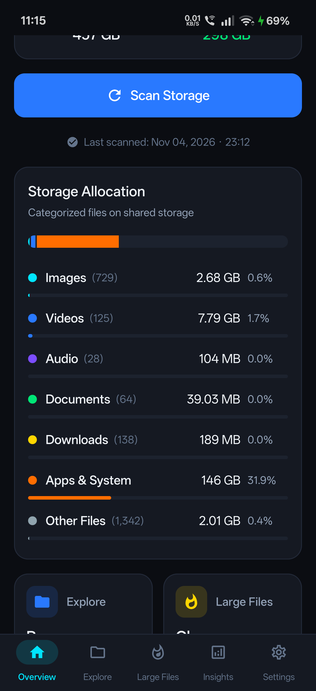
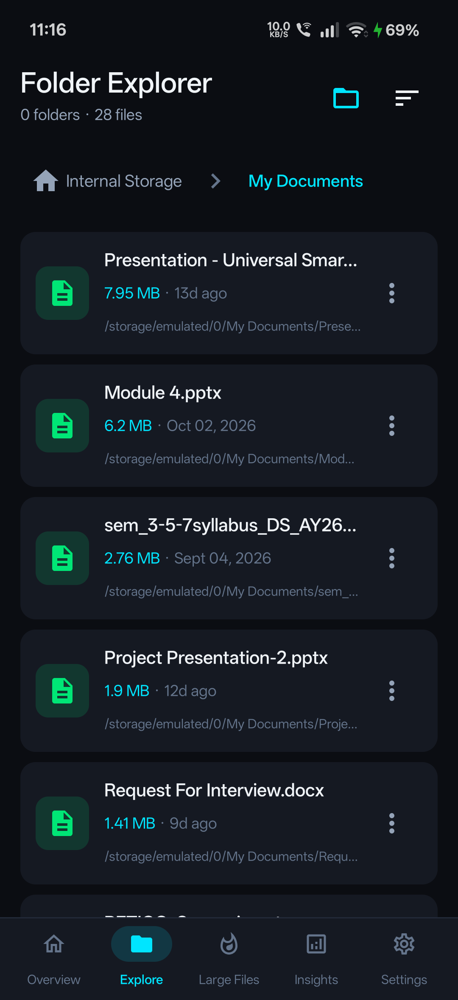
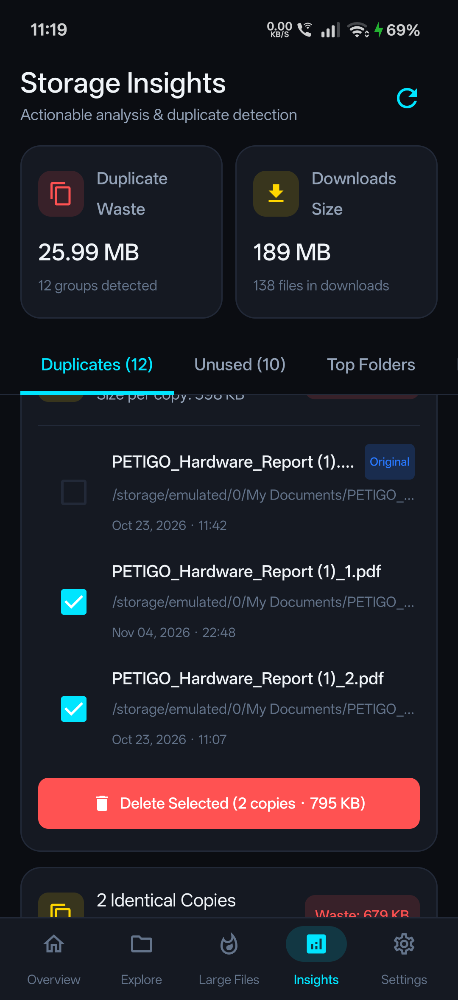
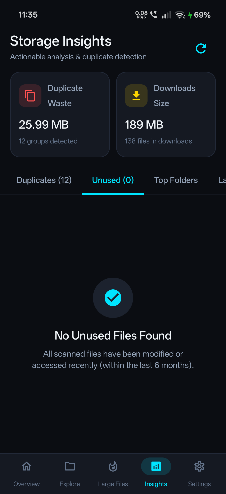

<div align="center">

# 🔍 StorageLens

### Modern Open-Source Android Storage Analyzer & Disk Manager

[](https://github.com/rehaan212006/StorageLens/releases/latest)
[](https://android.com)
[](https://kotlinlang.org)
[](https://developer.android.com/jetpack/compose)
[](LICENSE)
[](SECURITY.md)

<p align="center">
  <a href="https://github.com/rehaan212006/StorageLens/releases/latest/download/StorageLens-v1.0.0.apk">
    
  </a>
</p>

**StorageLens** is a modern, privacy-first, open-source Android storage analyzer and cleaner engineered with **Jetpack Compose**, **Material 3**, and **Kotlin Coroutines**. It empowers you to understand device storage consumption, detect exact duplicates via streaming **SHA-256**, explore folders with interactive breadcrumbs, and safely free up gigabytes of space—without tracking, telemetry, or network permissions.

</div>

---

## 📱 Screenshots

<div align="center">
<table>
  <tr>
    <td align="center" width="25%">
      <b>Overview Dashboard</b><br/><br/>
      
    </td>
    <td align="center" width="25%">
      <b>Folder Explorer</b><br/><br/>
      
    </td>
    <td align="center" width="25%">
      <b>Duplicate Detector</b><br/><br/>
      
    </td>
    <td align="center" width="25%">
      <b>Storage Insights</b><br/><br/>
      
    </td>
  </tr>
</table>
</div>

---

## ✨ Features

- 📊 **Real-Time Storage Dashboard**:
  - Live device capacity, used, and free space reading directly from native Android APIs (`StatFs` and `StorageManager`).
  - Animated sweep-gradient circular storage gauge with electric blue and cyan accents.
  - Multi-category breakdown (Images, Videos, Audio, Documents, Downloads, Apps & System, Other Files) with proportional segmented progress bars.
  - Asynchronous background scanner with real-time percentage progress and cancellation support.

- 👥 **Duplicate Files Detection (SHA-256)**:
  - **Two-stage sieve**: High-speed file-size pre-filter followed by chunked streaming **SHA-256 hashing** in 64 KB memory buffers to prevent Out-Of-Memory (OOM) crashes on large video files.
  - Discovers duplicate files regardless of differing file names or paths.
  - Automatic pre-selection of redundant copies with original copy protection and one-tap cleanup.

- 🗂️ **Deep Folder Explorer**:
  - Interactive breadcrumb navigation bar (`Internal Storage > My Documents > ...`).
  - Dynamic folder size and file count computation.
  - 4-way sorting: Largest first, Smallest first, Alphabetical (A-Z), and Recently modified.
  - Storage Access Framework (SAF) integration for custom folder selection.

- 🐘 **Large Files Finder**:
  - Quick-filter chips: `> 100 MB`, `> 250 MB`, `> 500 MB`, `> 1 GB`.
  - Filter by media type (Videos, Images, Documents, Audio, Other).
  - Date-modified badges and cumulative size calculation.

- 💡 **Actionable Storage Insights**:
  - Unused / Stale file detection with DOS-epoch guard against false 1980 archive dates.
  - Largest individual files and largest directories ranking.
  - Downloads folder usage and waste analysis.

- 🛡️ **Privacy by Design**:
  - **100% Offline**: Zero internet permission (`android.permission.INTERNET` is completely absent from `AndroidManifest.xml`).
  - **Zero Telemetry**: No analytics, third-party trackers, crash reporters, or advertising SDKs.
  - **Native Scoped Storage**: Implements `MediaStore.createDeleteRequest` so deletions are verified through the Android system dialog.

---

## 🏗️ Architecture & Technology Stack

StorageLens is built following modern Android Architecture Components (MVVM) and Clean Architecture principles:

```
app/
 ├── data/
 │    ├── datasource/      # DeviceStorageDataSource, MediaStoreDataSource, FileSystemDataSource, SafDataSource
 │    ├── models/          # StorageStats, StorageCategory, FileItem, FolderItem, DuplicateGroup, ScanState
 │    ├── preferences/     # UserPreferencesRepository (Jetpack DataStore)
 │    └── repository/      # StorageRepository & StorageRepositoryImpl
 ├── domain/
 │    └── usecases/        # GetDeviceStorage, ScanStorage, GetLargeFiles, FindDuplicates, GetStorageInsights, DeleteFile
 ├── permissions/          # PermissionManager (Granular Media permissions API 33+ & All Files Access)
 ├── scanner/              # StorageScanner (Coroutines Dispatchers.IO), DuplicateDetector (SHA-256)
 ├── ui/
 │    ├── components/      # CircularStorageGauge, CategoryProgressBar, StorageCard, FileListItem, FolderListItem
 │    ├── screens/         # Overview, Explore, LargeFiles, Insights, Settings
 │    └── theme/           # Color palette, Material 3 Typography & Themes
 ├── navigation/           # StorageLensNavHost, BottomNavBar, Screen routes
 └── utils/                # StorageFormatter, HashUtils (streaming SHA-256), MimeUtils, DateFormatter
```

| Component | Technology |
|---|---|
| **Language** | [Kotlin 1.9.23](https://kotlinlang.org) |
| **UI Framework** | [Jetpack Compose](https://developer.android.com/jetpack/compose) with [Material 3](https://m3.material.io) |
| **Async & Concurrency** | [Kotlin Coroutines](https://kotlinlang.org/docs/coroutines-overview.html) & [StateFlow](https://developer.android.com/kotlin/flow/stateflow-and-sharedflow) |
| **Persistence** | [Jetpack DataStore Preferences](https://developer.android.com/topic/libraries/architecture/datastore) |
| **File Systems** | [MediaStore API](https://developer.android.com/training/data-storage/shared/media) & [Storage Access Framework (SAF)](https://developer.android.com/guide/topics/providers/document-provider) |
| **Hashing Engine** | Streaming `MessageDigest` SHA-256 (64 KB chunked buffers) |
| **Target / Min SDK** | Target SDK 34 (Android 14) / Min SDK 29 (Android 10) |
| **Build Tooling** | Gradle 8.5 with Kotlin DSL |

---

## 🔒 Permissions Breakdown

StorageLens requests only the permissions strictly required for on-device disk analysis:

| Permission | API Level | Purpose |
|---|---|---|
| `READ_MEDIA_IMAGES` | 33+ | Discover and analyze photo storage consumption |
| `READ_MEDIA_VIDEO` | 33+ | Discover and analyze video storage consumption |
| `READ_MEDIA_AUDIO` | 33+ | Discover and analyze audio and music file consumption |
| `READ_EXTERNAL_STORAGE` | 29–32 | Legacy storage access for Android 10–12 devices |
| `MANAGE_EXTERNAL_STORAGE` | 30+ | Storage analysis and non-media document discovery across device folders |
| `INTERNET` | **None** | **Omitted** — StorageLens cannot connect to the internet |

---

## 📥 Download & Installation

### Option 1: Direct APK Download
Download the latest APK from the [Releases](https://github.com/rehaan212006/StorageLens/releases) page:
👉 **[Download StorageLens-v1.0.0.apk](https://github.com/rehaan212006/StorageLens/releases/latest/download/StorageLens-v1.0.0.apk)**

### Option 2: Build From Source
```bash
# Clone the repository
git clone https://github.com/rehaan212006/StorageLens.git
cd StorageLens

# Build debug APK
./gradlew assembleDebug

# Install directly to a connected device via adb
./gradlew installDebug
```

---

## 🤝 Contributing

Contributions are welcome! Whether you want to report a bug, suggest an enhancement, or submit a pull request, please see our [**Contributing Guide**](CONTRIBUTING.md) to get started.

---

## 📄 License

StorageLens is licensed under the [Apache License 2.0](LICENSE).
You are free to use, modify, and distribute this software in compliance with the license.
